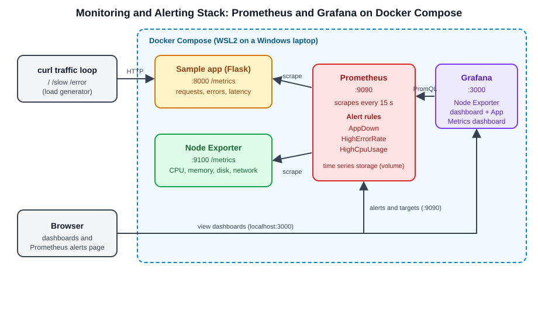
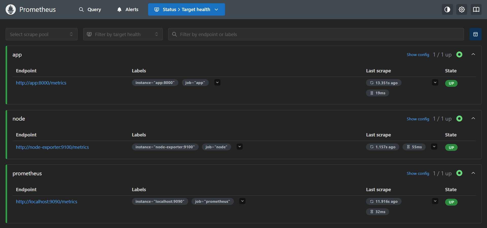
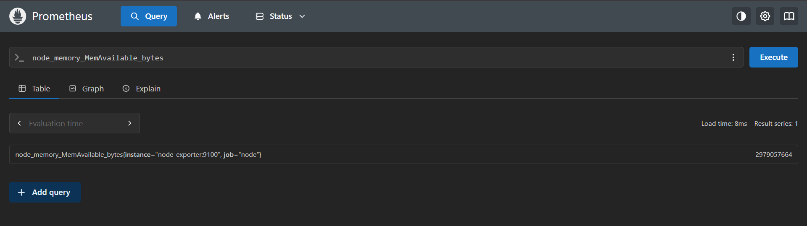
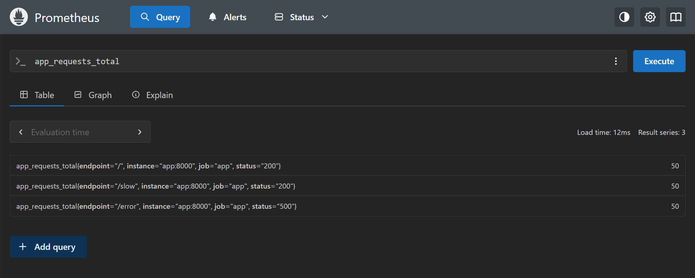
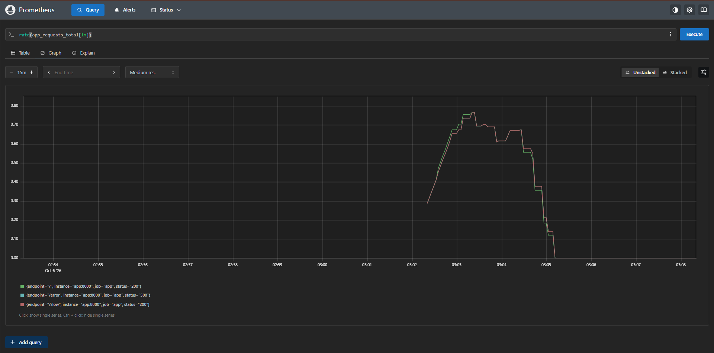
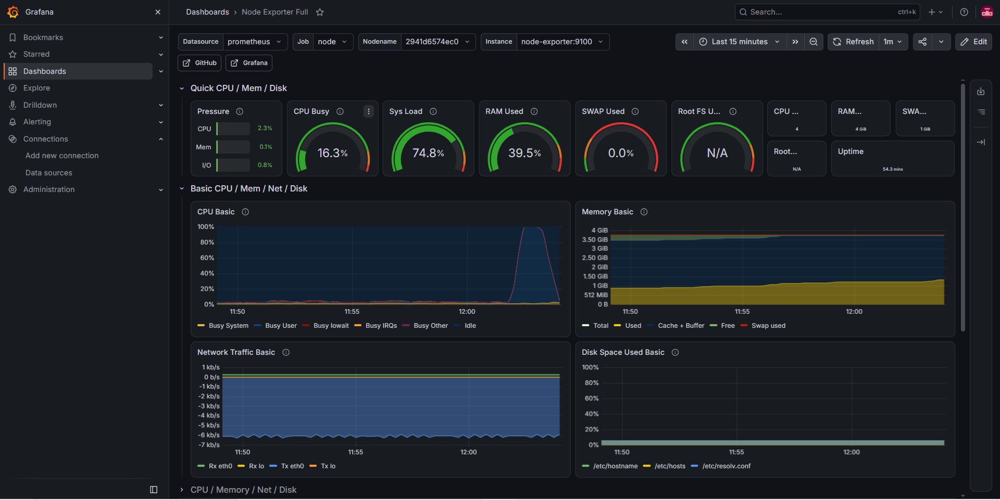
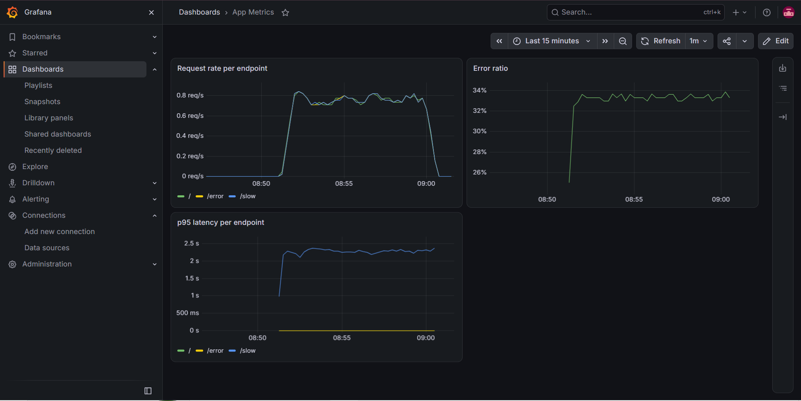
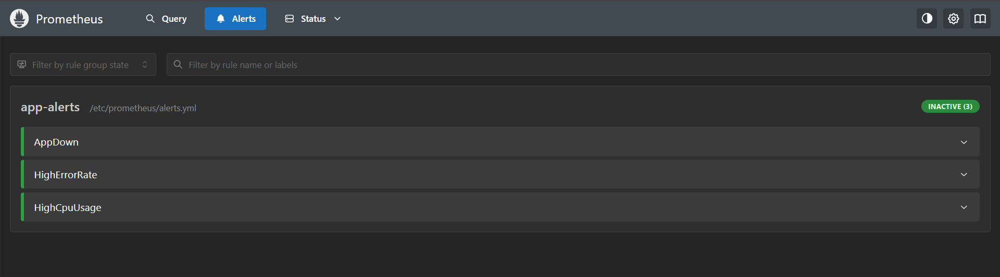
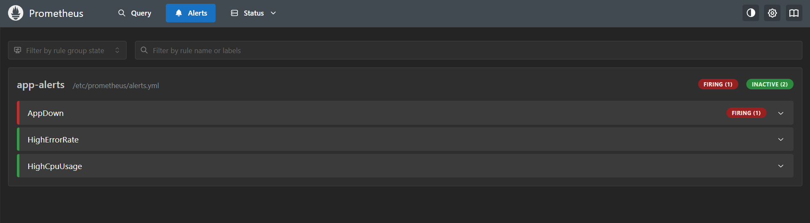
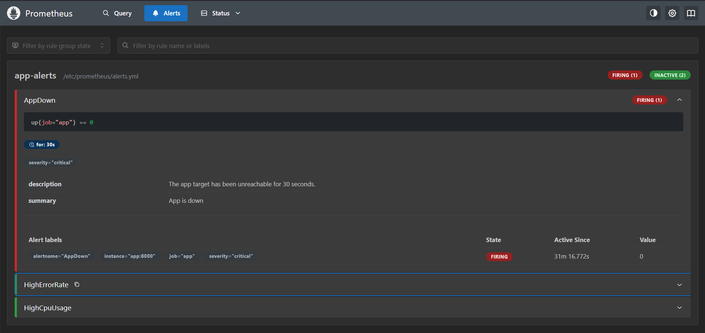

# Monitoring and Alerting with Prometheus and Grafana

A self-contained monitoring stack that runs locally with Docker Compose. Prometheus collects metrics from the host and from a sample Flask app that exposes its own metrics, Grafana turns them into dashboards, and Prometheus alert rules fire when the app goes down, fails too many requests, or the CPU is overloaded.



## What it does

- Collects **host metrics** (CPU, memory, disk, network) with Node Exporter
- Collects **application metrics** (request count, errors, latency) from a small instrumented Flask app
- Shows both in **Grafana dashboards**: the community Node Exporter Full dashboard plus a custom *App Metrics* dashboard
- Evaluates **alert rules** in Prometheus and shows them on the Alerts page

## Tech stack

| Tool | Role |
|---|---|
| Docker and Docker Compose | Runs the whole stack with one command |
| Prometheus | Scrapes metrics every 15 seconds, stores them, evaluates alert rules |
| Node Exporter | Exposes host CPU, memory, disk and network metrics |
| Grafana | Dashboards on top of Prometheus |
| Python, Flask and prometheus_client | Sample app exposing a `/metrics` endpoint |
| PromQL | Queries for rates, error ratio and latency percentiles |

## Repository structure

```
monitoring-prometheus-grafana/
├── docker-compose.yml        # prometheus, node-exporter, app, grafana
├── prometheus/
│   ├── prometheus.yml        # scrape jobs and rule file
│   └── alerts.yml            # alert rules
├── app/
│   ├── app.py                # Flask app with Prometheus metrics
│   ├── requirements.txt
│   └── Dockerfile
└── docs/
    ├── architecture.svg
    └── screenshots/
```

## Quick start

**Requirements:** Docker with Compose (Docker Desktop with WSL2 works).

```bash
git clone https://github.com/kedarg96/monitoring-prometheus-grafana.git
cd monitoring-prometheus-grafana
docker compose up -d --build
docker compose ps
```

| Service | URL |
|---|---|
| Prometheus | http://localhost:9090 |
| Grafana | http://localhost:3000 (login `admin` / `admin`, change the password on first login) |
| Sample app | http://localhost:8000 |
| Node Exporter | http://localhost:9100/metrics |

**Set up Grafana (first time):**
1. *Connections > Data sources > Add data source > Prometheus*, with the URL `http://prometheus:9090` (the container name, not `localhost`), then *Save & test*.
2. *Dashboards > New > Import*, enter `1860` (Node Exporter Full) and choose the Prometheus data source.
3. Create an *App Metrics* dashboard with the three panels below.

## The sample app

The Flask app exposes three endpoints and a `/metrics` page:

| Endpoint | Behaviour |
|---|---|
| `/` | Returns immediately with HTTP 200 |
| `/slow` | Sleeps 0.2 to 1.5 seconds, then returns 200 |
| `/error` | Returns HTTP 500 |
| `/metrics` | Prometheus metrics: `app_requests_total` and `app_request_duration_seconds` |

Generate traffic:

```bash
for i in $(seq 1 300); do curl -s localhost:8000/ > /dev/null; curl -s localhost:8000/slow > /dev/null; curl -s localhost:8000/error > /dev/null; sleep 0.4; done
```

## Dashboard queries (App Metrics)

| Panel | PromQL | Unit |
|---|---|---|
| Request rate per endpoint | `sum by (endpoint) (rate(app_requests_total[1m]))` | requests/sec |
| Error ratio | `sum(rate(app_requests_total{status="500"}[1m])) / sum(rate(app_requests_total[1m]))` | percent (0.0-1.0) |
| p95 latency per endpoint | `histogram_quantile(0.95, sum by (le, endpoint) (rate(app_request_duration_seconds_bucket[1m])))` | seconds |

## Alert rules

Defined in `prometheus/alerts.yml` and evaluated every 15 seconds.

| Alert | Condition | For |
|---|---|---|
| `AppDown` | `up{job="app"} == 0` | 30 s |
| `HighErrorRate` | More than 20% of requests return 500 | 1 m |
| `HighCpuUsage` | CPU usage above 80% | 2 m |

**Try it:** stop the app and watch the alert go from pending to firing on http://localhost:9090/alerts.

```bash
docker compose stop app      # wait about a minute
docker compose start app     # the alert clears again
```

## Screenshots

### 1. Prometheus targets


### 2. Querying Prometheus






### 3. Grafana: host metrics (Node Exporter Full)


### 4. Grafana: application metrics


### 5. Alert rules, all healthy


### 6. AppDown alert firing




## Problems I ran into and how I solved them

- **Config changes not applied.** Prometheus only reads its config at startup, so editing `prometheus.yml` did nothing until I recreated the container with `docker compose up -d --force-recreate prometheus`.
- **YAML errors from pasted files.** Stray lines at the end of a pasted file broke the Compose file and put Prometheus into a restart loop. I learned to read `docker compose logs`, validate with `docker compose config`, and check rules with `promtool check rules`.
- **cAdvisor could not label containers.** I tried adding cAdvisor for per-container metrics, but under Docker Desktop with WSL2 it could not reach the container runtime, so metrics had no container names. After testing a newer image and the namespace flag, I removed it and kept host metrics (Node Exporter) and application metrics instead.
- **Empty `rate()` graphs.** A rate over one minute is zero when no requests arrived in that window. I generated steady traffic with a loop to see it properly.

## Known limitations

- Node Exporter runs in a container, so it reports the WSL2 virtual machine, and disk panels only show the container's own mounts.
- The p95 latency is estimated from histogram buckets, so it can read higher than the true value because the default buckets are coarse.
- Alerts appear on the Prometheus Alerts page only. Nothing sends an email or Slack message yet.

## Possible improvements

- Add Alertmanager to send notifications to email or Slack
- Export the Grafana dashboards as JSON and provision them automatically
- Add per-container metrics where the container runtime allows it
- Run the stack on a Kubernetes cluster with Helm

## Author

Kedar Gokhale
